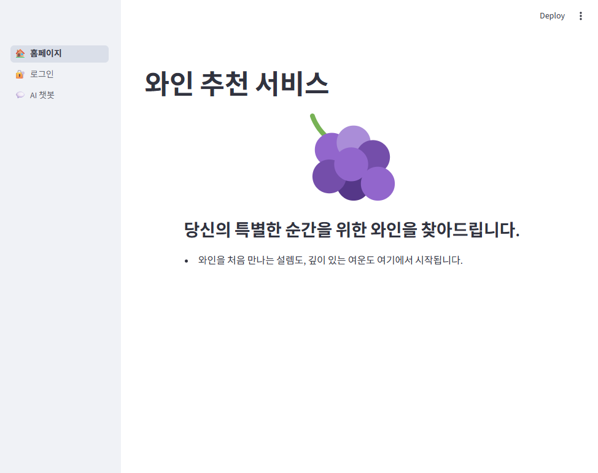
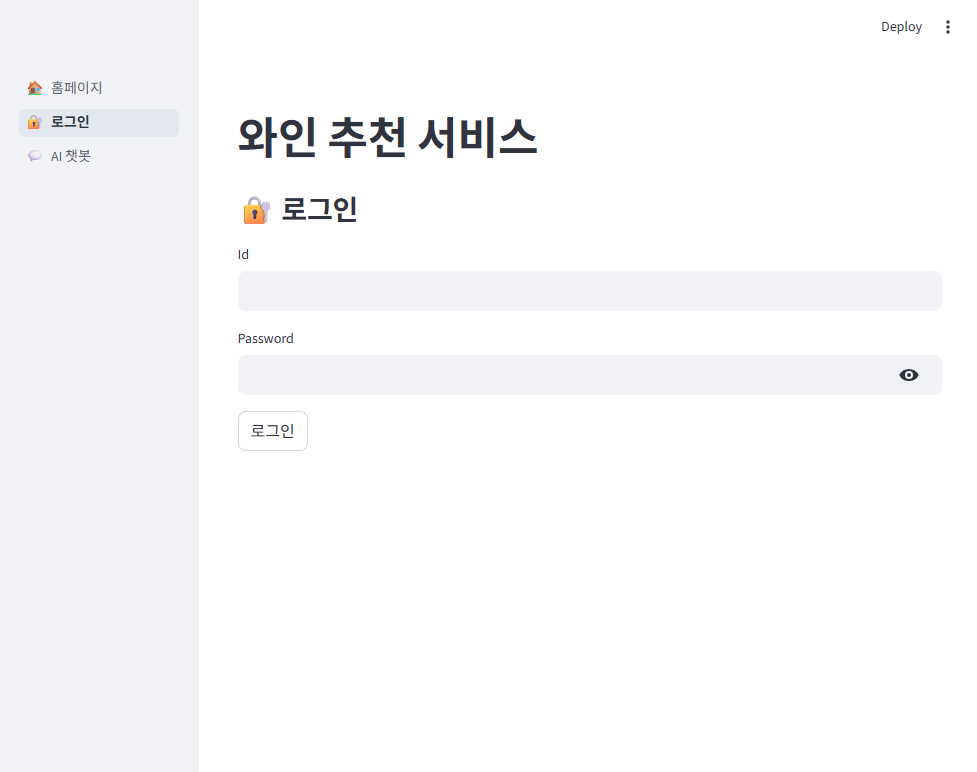
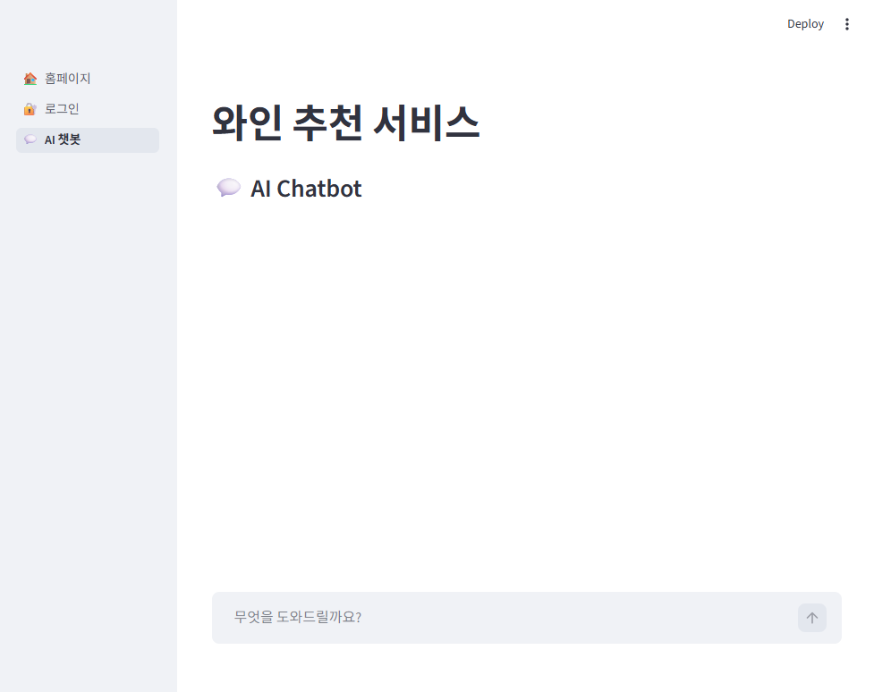

# 🍷 AI 소믈리에 - 와인 추천 서비스

AI 챗봇과 대화하며 상황에 맞는 와인을 추천받을 수 있는 웹 서비스입니다.
상황·음식·예산·취향을 선택하거나 채팅으로 자유롭게 이야기하면, AI 소믈리에가 와인 2~3개를 추천 이유와 페어링 팁과 함께 알려드립니다.

## 주요 화면

| 메인 | 로그인 | AI 소믈리에 |
|---|---|---|
|  |  |  |

## 주요 기능

- **조건 기반 추천** : 상황·예산·음식·취향을 선택하면 질문 문장으로 변환해 바로 추천 요청
- **대화형 추천** : 정보가 부족하면 AI가 필요한 정보를 되묻고, 충분하면 정해진 형식으로 추천
- **스트리밍 응답** : 답변이 실시간으로 출력되는 대화 경험
- **멀티턴 대화** : 대화 이력을 유지해 이전 맥락을 이어서 상담
- **예외 처리** : API 오류 시 안내 메시지 노출 및 실패한 질문 이력 제거

## 기술 스택

- Python 3.12
- Streamlit
- OpenAI API (gpt-5-nano)
- python-dotenv

## 프로젝트 구조

```
semi_project/
├── static/
│   ├── app.py      # 엔트리 포인트, 멀티 페이지 네비게이션
│   ├── main.py     # 메인 랜딩 페이지
│   ├── login.py    # 로그인 페이지 (입력 검증 UI)
│   ├── chat.py     # AI 소믈리에 챗봇
│   └── logo.svg
├── requirements.txt
└── .env.example
```

## 실행 방법

```bash
# 1. 가상환경 생성 및 패키지 설치
python -m venv .venv
source .venv/bin/activate
pip install -r requirements.txt

# 2. 환경 변수 설정 (.env 파일에 OpenAI API Key 입력)
cp .env.example .env

# 3. 실행
streamlit run static/app.py
```

## 구현 포인트

### 시스템 프롬프트 설계
추천에 필요한 정보(상황·음식·예산·취향)가 부족하면 바로 추천하지 않고 되묻도록 대화 규칙을 정의했습니다.
추천 시에는 와인명·가격대·추천 이유·페어링 팁 형식을 고정해 답변 품질을 일정하게 유지합니다.

### 조건 선택 → 프롬프트 변환
폼에서 선택한 조건 중 값이 있는 항목만 골라 자연어 질문으로 변환합니다.
채팅과 폼 두 입력 경로가 같은 처리 함수(`handle_user_message`)를 사용하도록 구성했습니다.

### API Key 분리
API Key는 `.env` 파일로 분리하고 저장소에는 포함하지 않습니다.
